  

&nbsp;

&nbsp;

  

---

### 👨‍💻 About Me

🎓 &nbsp; CS @ UMBC, graduating **December 2026**
 
🔧 &nbsp; Building across **Full-Stack, Data Engineering & AI**
 
📍 &nbsp; Based in **Elkridge, MD**
 
📬 &nbsp; Reach me at **fatinm1@umbc.edu**

## 🚀 Featured Projects

<table>
  <tr>
    <td width="50%" valign="top">
      <h3 align="center">TokenForge</h3>
      
<strong>C++ LLM Inference Engine</strong>

      
<a href="https://fatinm1.github.io/LLM-Engine/">Live site</a> · <a href="https://github.com/fatinm1/LLM-Engine">Code</a> · <a href="https://github.com/user-attachments/assets/f90024b7-6b12-49b7-998a-685a7004ccea">Watch 60-second demo</a>

      
A local inference engine built from scratch in C++: GGUF model loading, tokenization, transformer computation, KV caching, sampling, and a native desktop interface. Runs supported language models on CPU without an inference library.

      
C++ · OpenGL · CMake · Dear ImGui · GLFW · GoogleTest

    </td>
    <td width="50%" valign="top">
      <h3 align="center">LectureKit</h3>
      
<strong>Multi-Agent Lecture Study Platform</strong>

      
<a href="https://lecture-kit.vercel.app/">Live site</a> · <a href="https://github.com/fatinm1/lectureKit">Code</a> · <a href="https://github.com/user-attachments/assets/995f1709-85bb-4c6b-8cf3-573899152b49">Watch 60-second demo</a>

      
Turns public YouTube lectures into timestamped outlines, summaries, flashcards, semantic search, and translated study material. Six AI agents also support faculty pedagogy audits and curriculum coverage reports.

      
Next.js · TypeScript · FastAPI · Claude API · ChromaDB

    </td>
  </tr>
  <tr>
    <td width="50%" valign="top">
      <h3 align="center">ClausePilot</h3>
      
<strong>AI-Assisted NDA Review &amp; Redlining</strong>

      
<a href="https://github.com/fatinm1/ClausePilot">Code</a> · <a href="https://github.com/user-attachments/assets/da42192f-01f1-48c5-96e3-4b6222fd1575">Watch 60-second demo</a>

      
Reviews and redlines Word NDAs using GPT-4 and admin-defined rules. Supports an accept/reject review workflow, firm details, signature insertion, and downloadable edited documents.

      
Next.js · TypeScript · Flask · PostgreSQL · python-docx

    </td>
    <td width="50%" valign="top">
      <h3 align="center">TheraSync</h3>
      
<strong>Therapy Appointment Scheduling Platform</strong>

      
<a href="https://github.com/fatinm1/Therapy-Scheduling">Code</a> · <a href="https://github.com/user-attachments/assets/ad734257-3aa1-40c4-9f8a-e9261b54701f">Watch 60-second demo</a>

      
Coordinates therapy appointments across parents, students, therapists, and admins. Includes role-based dashboards, therapist availability, chatbot scheduling, and email notifications. <strong>Development demo; not currently deployed.</strong>

      
React · Flask · MySQL · JWT · spaCy

    </td>
  </tr>
</table>

---

## 🛠️ Tech Stack

**Languages**

<i>Python &middot; TypeScript &middot; JavaScript &middot; Java &middot; C++ &middot; C &middot; Bash</i>

 

**Frontend**

<i>React &middot; Next.js &middot; Angular &middot; HTML &middot; CSS</i>

 

**Backend and Databases**

<i>FastAPI &middot; Flask &middot; PostgreSQL &middot; MySQL &middot; MongoDB &middot; Redis</i>

 

**DevOps**

<i>Docker &middot; GitHub Actions &middot; Azure &middot; Git &middot; Linux</i>

 

**AI and Data**

<i>PyTorch &middot; TensorFlow &middot; BigQuery &middot; dbt &middot; NumPy</i>

---

## 📊 GitHub Stats

  
  
  
Public repository stats, refreshed daily. Language percentages reflect repository code size, not proficiency.

### 🐍 Contribution Snake

---

  <i>Open to New Grad/Early Career SWE positions.</i>
    
  

